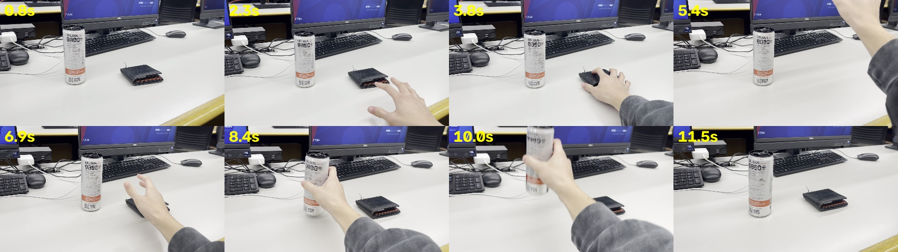

# Wallet then can: temporal-order probe (2026-11-08)

**Setup.** SmolVLM2-500M-Video-Instruct, float32, greedy decoding, M1 GPU (macOS 13.7). Clip `IMG_6524.MOV`: 12.3 s, 30 fps, 1920×1080. The hand picks up a wallet (about 2–7 s), puts it down, then picks up a can (about 8–11 s). Correct answer: **wallet first**.

The frames are correctly oriented, in order, and cover both pickups. The wallet is small and dark, and it leaves the top of the frame when lifted (5.4 s). The can is large and visible in every frame.

## 1. The answer follows the prompt, not the video

8 uniform frames unless noted.

| Prompt | Answer |
|---|---|
| "…The **can** or wallet?" (8 and 16 frames; 32 frames gave the same) | can |
| "…The **wallet** or the can?" (8 and 16 frames) | wallet |
| "A) wallet **B) can**. Answer with the letter." | B |
| "A) can **B) wallet**. Answer with the letter." | B |
| "Did I pick up the wallet / the can / the **keyboard**? Answer yes or no." | yes / yes / yes |
| "What object did I pick up first? Answer with one word." | Can |
| "Describe step by step what the hand does." (16 frames) | Only mentions the can |

**Biases:** it picks the first-named option, picks the letter B, and answers yes to everything.

## 2. Changing which frames it sees didn't help

Total budget of 8 frames in every row. "Motion" spaces frames evenly along cumulative frame difference instead of time, so they cluster where things move.

| Method | Frames (s) | Can-first order / wallet-first order / open-ended |
|---|---|---|
| Uniform | 0.8 2.3 3.8 5.4 6.9 8.4 10.0 11.5 | can / wallet / Can |
| Motion | 1.8 3.6 5.2 6.7 8.4 9.4 10.3 11.4 | can / wallet / Can |

**Split the clip and ask "What object is the hand picking up?" for each segment.** The order then comes from which segment names which object.

| Segment | Truth | Uniform | Motion |
|---|---|---|---|
| 0.0–6.1 s (4 frames) | wallet | Can | Can |
| 6.1–12.3 s (4 frames) | can | Can | Can |
| 0.0–3.1 s (2 frames) | reaching for the wallet | **wallet** | Can |
| 3.1–6.1 s (2 frames) | wallet lifted | Can | Can |
| 6.1–9.2 s (2 frames) | wallet down, can grabbed | Can | can |
| 9.2–12.3 s (2 frames) | can lifted | Can | Can |

## Takeaways: what to improve

1. **Recognition is the bottleneck, not frame timing.** The model names the most visible object, the can, even in segments where only the wallet moves. Uniform, motion-based and segmented frame choices all fail the same way.
2. **Next lever: spatial focus.** The processor squashes each 16:9 frame into 512×512, which shrinks the wallet further. Ideas:
   - crop to the region that moves (the hand and object)
   - keep the aspect ratio, padding instead of squashing
   - give the active frames more resolution
3. **Evaluation must control for prompt bias:**
   - ask each multiple-choice question in both option orders, and count it correct only if both answers are right
   - make half the yes/no answers "no"
   - report the "always first option" and "always yes" baselines
4. **Clip design is a confound.** When the object that isn't picked up is visible in every frame, it competes with the object that is. Record that as a variable instead of designing it away.
